# curl UI

A native desktop API client built on [curl](https://curl.se), written in C11 with
SDL2 and Nuklear. Tabs, collections, environments, secrets, history and forms, plus
all 278 command line options, each with curl's own documentation one mouse movement
away. It runs your real `curl` binary and re-implements nothing.

curl UI is an independent project and is not part of curl. The curl program is
not included: packages depend on it, and the app uses the one on your system.

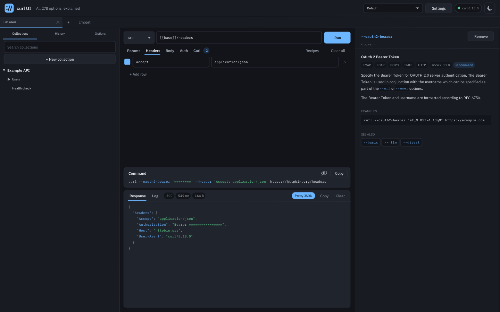

## Get started

1. [Install it](#install), and open the app.
2. Type a URL and press Run. The Response tab shows the result.
3. Fill in Params, Headers, Body or Auth, or add any curl option under Curl.
4. Write `{{name}}` wherever a value changes between environments. The first run asks for it.
5. Press Ctrl/Cmd+S to keep the request in a collection.

## Why use it

- **Your real curl, nothing simulated.** The app starts the `curl` on your system
  with an argument array and no shell, so a result here is a result from curl.
- **An API client and all of curl.** Tabs, collections with their own variables and
  environments, history and forms for params, headers, body and auth, next to every one
  of curl's 278 options.
- **Every option, documented in place.** curl's own documentation appears as you
  hover over an option, a row or a flag in the command.
- **Only what can work together.** After each choice the option list narrows to what
  still combines with what you picked, and says why the others do not.
- **A command you can take with you.** The exact command is always on screen, and
  Copy gives you one that runs, for a script, a CI job or a ticket.
- **Private and local.** No account, no cloud and no telemetry. The app has no
  network code of its own: every connection is made by curl, when you press Run.
- **Small and native.** C11, SDL2 and Nuklear, with no browser engine. About a 1 MB
  download on Windows and macOS, free and open source.

## Who it is for

| You are | It helps you |
|---|---|
| A backend or API developer | keep your requests in collections, switch between environments, and see status, time, size and formatted JSON |
| A QA or support engineer | reproduce a problem and attach the exact command and its log to the report, with secrets hidden on screen |
| A DevOps or SRE engineer | check redirects, certificates, proxies and timeouts on the machine in question |
| Someone learning HTTP or curl | discover options by reading about them, and see what each one really does |

## Use cases

- **Work with an API across environments.** Write `{{base}}/users` once, keep the
  values in the collection's Dev and Prod, and switch between them in its Variables.
- **Debug an API call.** Fill in Auth and Body, and run. The Response tab formats the
  JSON, and the Log tab shows what was sent and received.
- **Take over a command you were given.** Press Import, paste the curl command, and it
  opens as a request you can change and save.
- **Find out why HTTPS fails.** Add `--cacert`, `--resolve` or `--tlsv1.2`, and read the
  handshake in the Log tab, with the documentation for each option beside it.
- **Write a command for a script.** Build it with `--retry`, `--connect-timeout` and
  `--max-time`, confirm that it works, and copy it into your CI job.
- **Transfer files.** Download with `--remote-name` and `--limit-rate`, resume with
  `--continue-at`, or upload with `--upload-file`, over HTTP, FTP and the other
  protocols your curl supports.

## When something else fits better

curl UI has no test scripts or assertions, no running of a whole collection, no
GraphQL, gRPC or WebSocket views, no mock servers and no shared team workspace. It
cannot yet import or export Postman collections. A full API platform suits that work
better, and for repeated automation, use the copied command directly.

## Install

Download from the [releases page](../../releases), where `SHA256SUMS` lists the
checksums, or from the artifacts of the `curl-ui` workflow run:

| Platform | File | Install |
|---|---|---|
| Windows x64 | `curl-ui-*-windows-x64.exe` | run the installer (`.zip` is the portable form) |
| Windows ARM64 | `curl-ui-*-windows-arm64.exe` | run the installer (`.zip` is the portable form) |
| Debian, Ubuntu (x86_64, ARM64) | `curl-ui_*_amd64.deb`, `curl-ui_*_arm64.deb` | `sudo apt install ./curl-ui_*.deb` |
| Fedora, RHEL (x86_64, ARM64) | `curl-ui-*.x86_64.rpm`, `curl-ui-*.aarch64.rpm` | `sudo dnf install ./curl-ui-*.rpm` |
| Any Linux (x86_64, ARM64) | `curl-ui-*-linux-*.AppImage` | `chmod +x`, then run it; SDL is included |
| Any Linux (x86_64, ARM64) | `curl-ui-*-linux-*.tar.gz` | unpack; needs SDL2 installed |
| macOS Apple Silicon | `curl-ui-*-macos-apple-silicon.dmg` | drag to Applications |
| macOS Intel | `curl-ui-*-macos-intel.dmg` | drag to Applications |

The builds are not code signed, so Windows SmartScreen and macOS Gatekeeper warn
the first time. On Windows choose More info, Run anyway. On macOS 15 and later,
try to open the app, then choose Open Anyway in System Settings, Privacy & Security;
on older versions use right click, Open.

curl itself must be installed. Windows 10 and later and macOS include it. If
it is not on `PATH`, click the version pill in the header and enter its path under Program.

## Using it

- **Left:** Collections and History.
- **Centre:** method and URL on top, then Params, Headers, Body, Auth and Curl, the exact
  command, and the output with Response and Log tabs. Press Enter in the URL, Ctrl/Cmd+Enter,
  or Run.
- **Curl:** every curl option. Search names and descriptions, filter with the chips, and
  click a row to add it as a card beside the list. Once an option is chosen, the list shows
  only what can still combine with everything chosen so far: what conflicts, and what belongs
  to another protocol (`--ftp-pasv` rules out `--user-agent`), steps aside, with a count and a
  Show all link to see it anyway. Removing an option brings back what it ruled out. Deprecated
  options stay out of the list unless you search or use the Deprecated filter under More, which
  is why it starts at 269 of 278. Recipes are starting points.
- **Right, on Curl:** hover a library row, a card or a flag in the command and that option's
  full documentation appears, and stays while you move over to read. Every `--option` in it is
  a link. Hide docs and Show docs close and open the panel, and the choice is kept.
- **Right, elsewhere:** This request: its collection, a choice of environment, and the variables
  it uses with their values, secrets hidden and missing ones marked.
- **Window:** on Linux and Windows the header has the buttons to minimize, maximize and close,
  drags the window, and its edges resize it. A Mac keeps its own buttons.
- **Files:** wherever a value is a file or a folder there is a Browse button beside the field:
  Body, Form data rows, Import, Settings, and the option cards. `--output` asks to save and warns
  about an existing file, `--capath` takes a folder, `--data` gets `@path`, and `--cert` keeps
  its `:password`. The picker opens in the last folder used. You can still type the path.

| Keys | Action |
|---|---|
| Ctrl/Cmd+Enter | run |
| Ctrl/Cmd+S | save the request |
| Ctrl/Cmd+T | new tab |
| Ctrl/Cmd+W | close the tab |

### Forms and options

The forms are views of curl's options, not a second set of settings. What you do in one
shows in the other and in the command. If the options say more than a form can show, such
as `--data` together with `--form`, the form says **Set by options** and leaves them alone.

| Form | Curl options |
|---|---|
| Params | the query of the URL, percent encoded. You type plain text |
| Headers | `--header` |
| Body | `--data-raw`, `--json`, `--form-string` and `--form`, `--data-urlencode`, `--data-binary @file` |
| Auth | Basic: `--basic --user`, which sends `Authorization: Basic base64(username:password)`. Digest: `--digest --user`. Bearer: `--oauth2-bearer`. API key: a header or a query parameter |

### Variables

Write `{{name}}` in the URL or any option. Each collection has its own table of variables
and its own environments, such as Dev and Prod: open them with **Variables...** in the
collection's menu, and the tree shows the environment in use when there is more than one. A
request takes its values only from its collection. One that is not saved uses **My requests**,
and saving it elsewhere brings along the variables it uses. The operating system's environment
is not read, and variables are not passed to it or to curl's environment.

Running with a variable that has no value sends nothing and asks for it, then saves it in
the table and carries on. curl receives the real value, so the final command does not
contain `{{name}}`. What you save keeps `{{name}}`: values stay in the table.

A variable marked **Secret** shows as stars in the table and the command, each with an eye
to see it. Copy gives the real value, so the command runs, and says so. In the Response and
the Log, secret values are hidden as they are, percent encoded, and as the
`base64(username:password)` of Basic auth.

### Collections, tabs and history

Each tab has its own request, response and run, and several can run at once. Ctrl/Cmd+S saves
a tab into a collection, and a dot marks unsaved changes. Ctrl/Cmd+T opens a tab, and
Ctrl/Cmd+W closes one. Open tabs come back at the next start. History keeps the last 500 runs, as
written, without responses. **Import**, next to the tabs, turns a pasted curl command into a
request. Nothing runs, and what only a shell could give a meaning to, such as a pipe or
`$HOME`, is refused by name.

To fill the Log tab and the status chips, a run also passes `--verbose`,
`--no-progress-meter` and `--write-out` to curl, when you did not set them
yourself. The Log says so on its first line, and they are not in the command you
copy. The rest of the command is exactly what is executed, as an argument array
with no shell. This can be turned off in Settings.

### Importing an API description

Import, then Open file, takes OpenAPI 3.2, 3.1 and 3.0 and Swagger 2.0, in JSON or YAML, and Swagger
1.2, 1.1 and 1.0 as a listing beside its declarations. It makes a new collection, with nothing sent
until you press Run, and the notice bar says what was made and what was left out.

| In the file | In the app |
|---|---|
| The title | Collection, as `Name 2` if the name is taken |
| The first tag, under the tags it names as parent | Folder |
| An operation | Request, named by its summary, its operationId, or its method and path |
| Servers, or host, basePath and schemes | One environment each, with `baseUrl` and the server's variables |
| Path parameters | `{{baseUrl}}/pets/{{petId}}` |
| Query and header parameters | Rows of Params and Headers: required on, others off, with the example or default, else `{{name}}` |
| Cookie parameters | `--cookie` |
| Security | The Auth form with empty secret variables. OAuth and OpenID Connect become Bearer with `{{token}}`, and mutual TLS gives `--cert` and `--key` to Browse for |
| A request body | JSON from its example or schema; rows of URL encoded or Form data; Raw; or File |

`$ref` is followed within the file and to files beside it. Files outside the folder of the first are named
in the report. A name that cannot be a variable has `_` for what it cannot hold. Secret variables start empty.

### Screenshots

| Variables, with secrets hidden | Asking for what is missing |
|---|---|
| 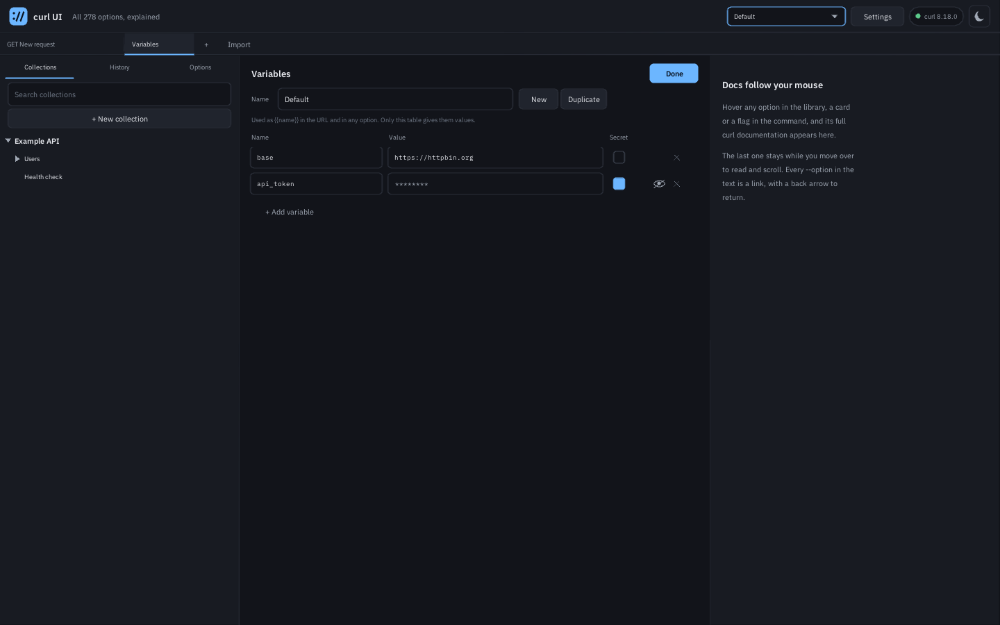 | 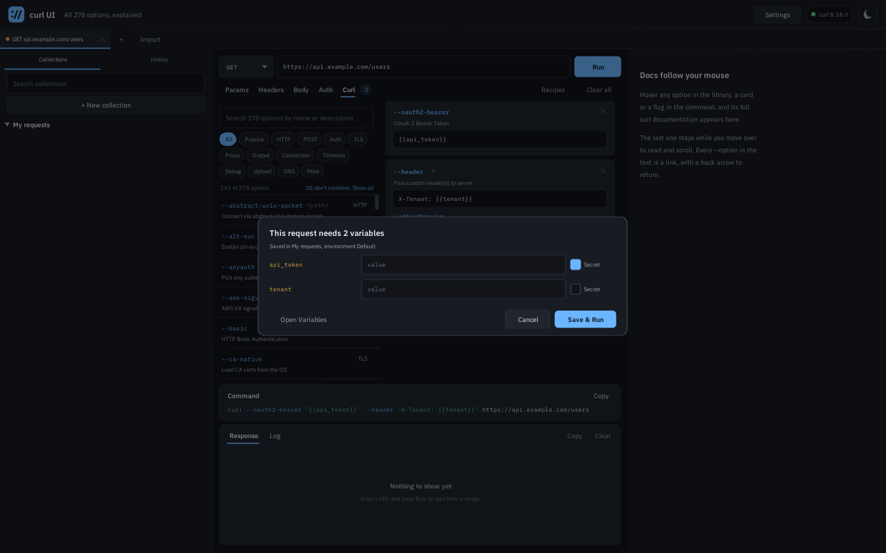 |

| Params, as plain text | Auth |
|---|---|
| 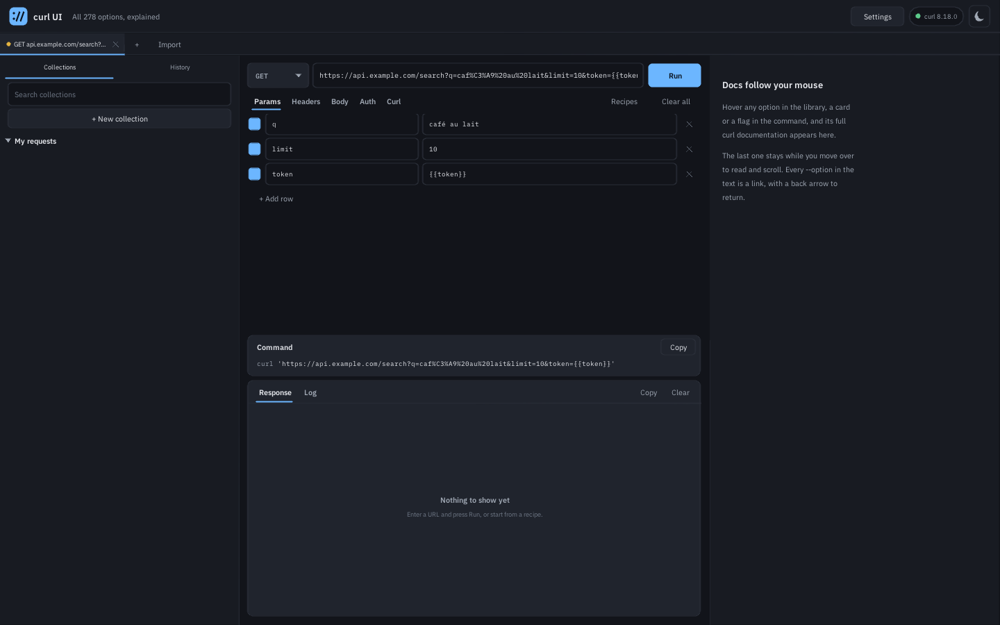 | 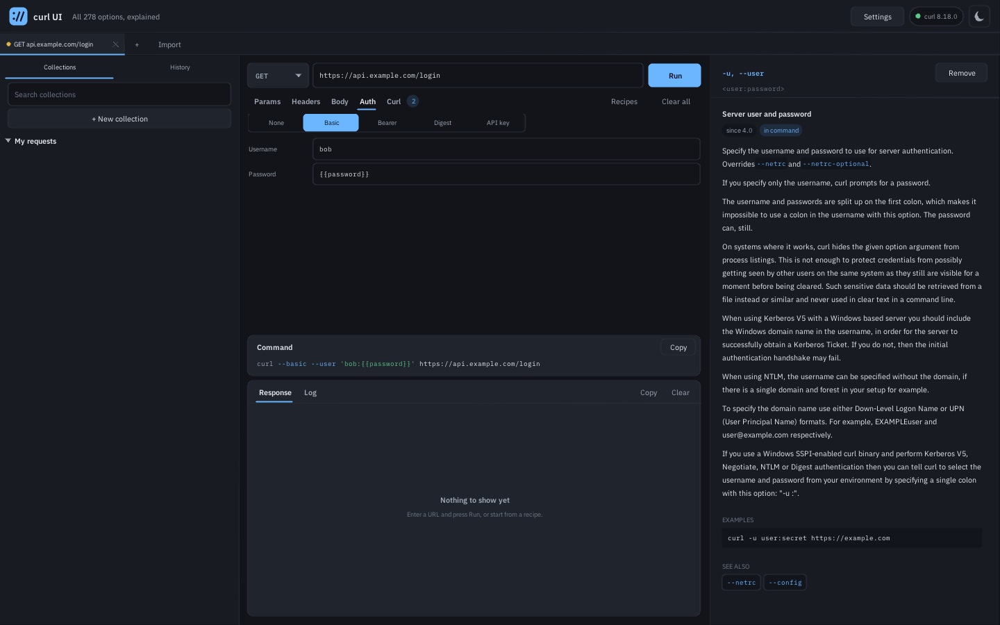 |
| 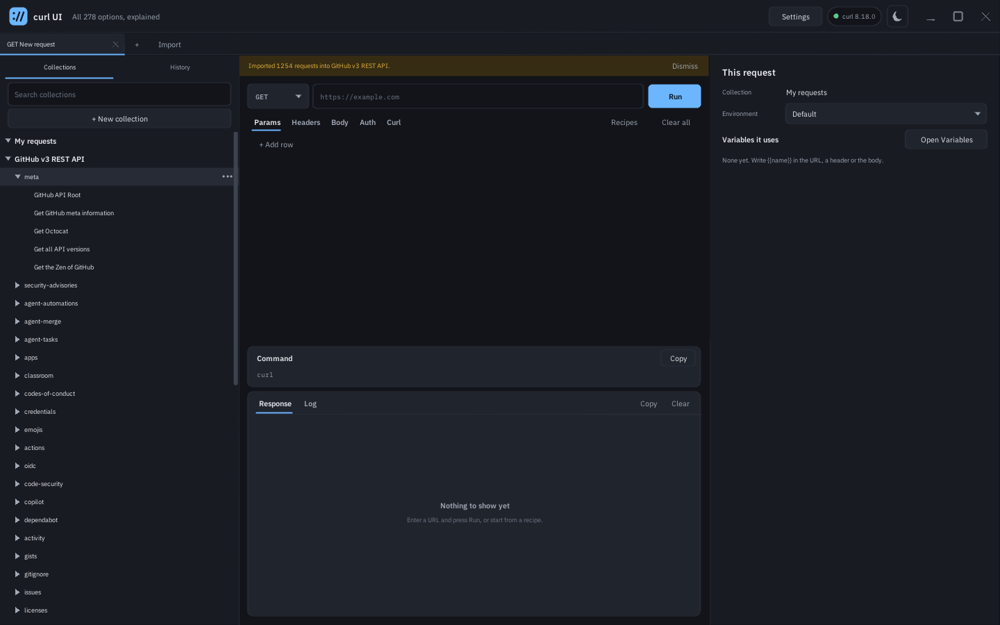 |  |

| Body | History |
|---|---|
| 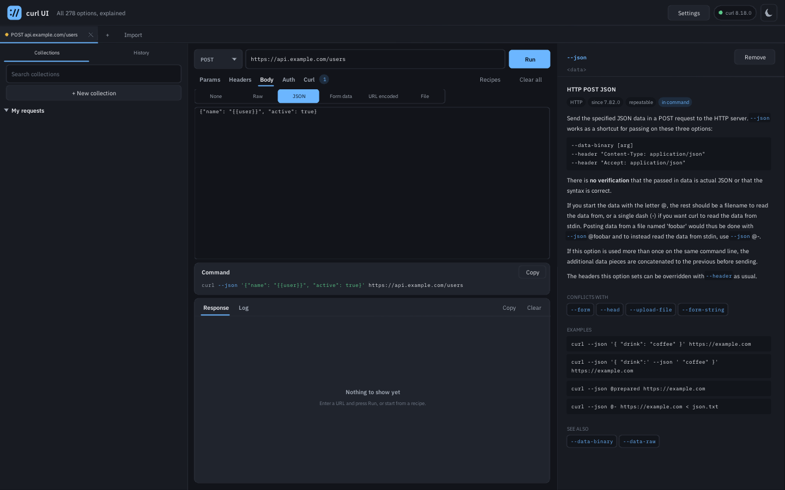 | 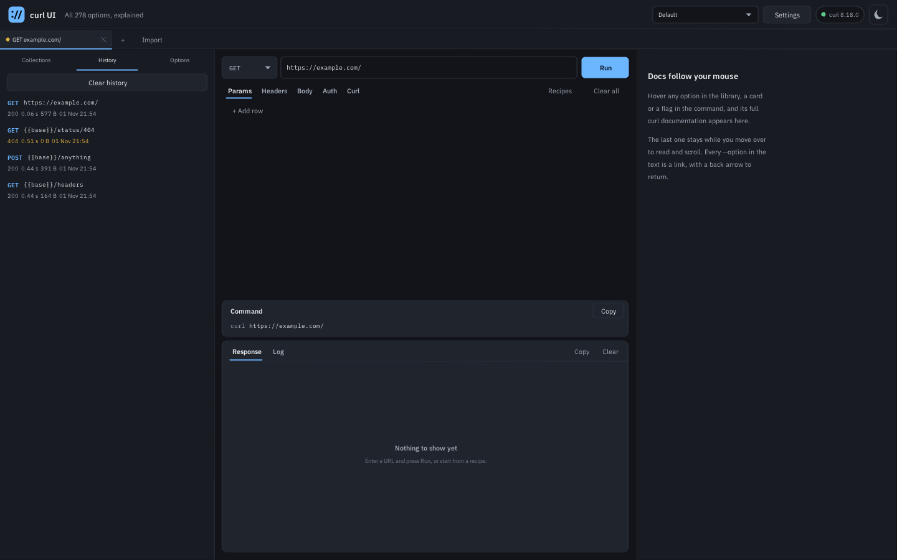 |

| Only what combines, or everything with the reason | Importing a curl command |
|---|---|
| 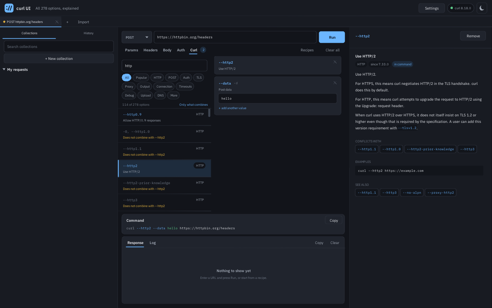 | 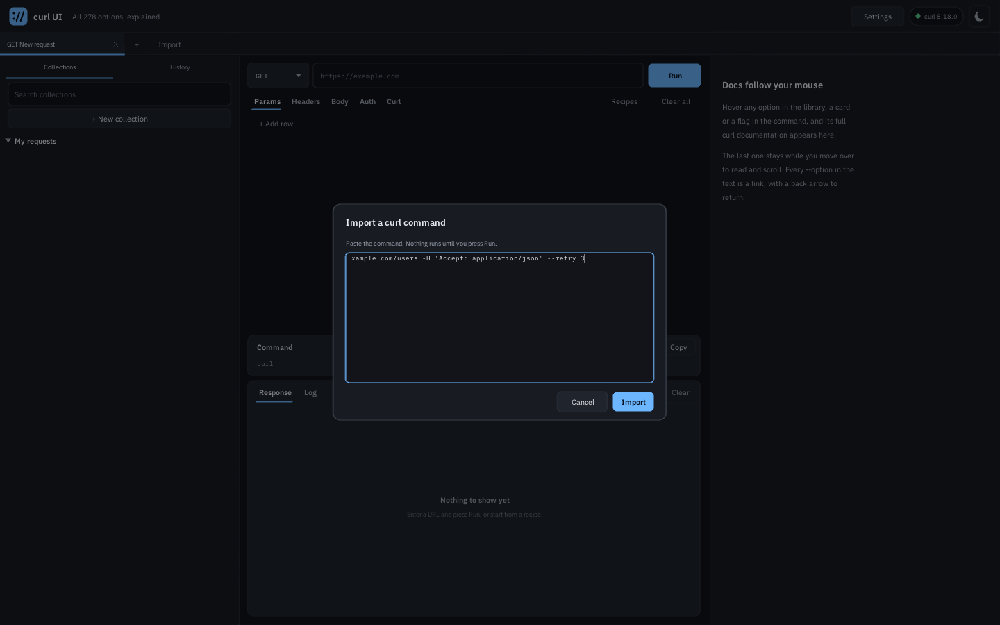 |

| The verbose log, in the light theme | Recipes to start from |
|---|---|
| 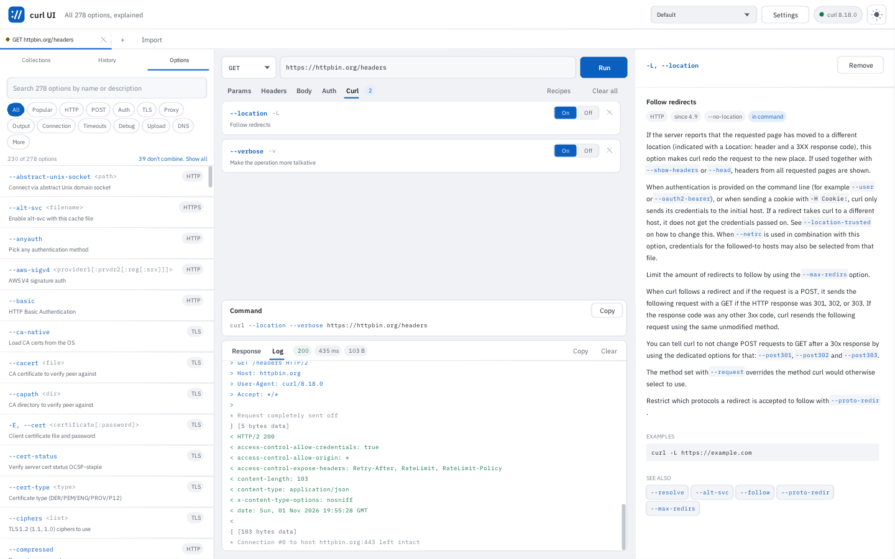 | 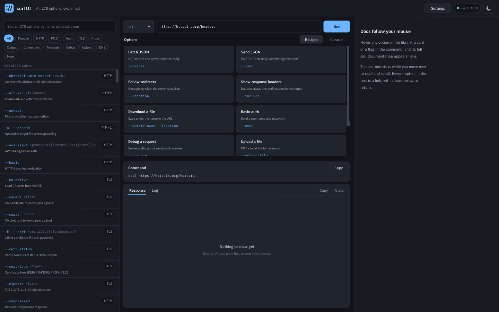 |

| Settings |
|---|
| 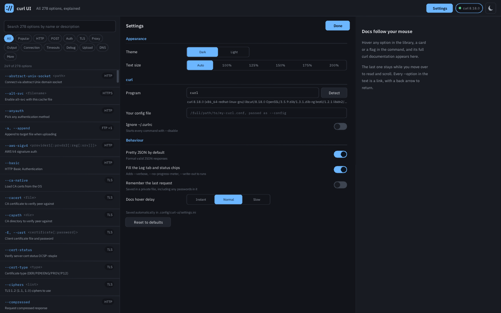 |

## Settings

The Settings button in the header, or the curl version pill beside it, opens them.
Changes apply at once and are saved automatically; **Reset to defaults** restores
the values in bold.

| In the app | Choices | What it does | Key in the file |
|---|---|---|---|
| Theme | **Dark**, Light | Colour theme, also on the header button | `theme`: `dark`, `light` |
| Text size | **Auto**, 100%, 125%, 150%, 175%, 200% | Auto follows the display's scale | `text_size`: `0` for Auto, or a percent |
| Program | **`curl`**, or a name or path | Which curl to run. Detect checks it again | `curl_program` |
| Your config file | **empty**, or a path | Passed as `--config` on every run | `curl_config` |
| Ignore ~/.curlrc | On, **Off** | Starts every command with `--disable` | `ignore_curlrc`: `1`, `0` |
| Pretty JSON by default | **On**, Off | Formats valid JSON responses | `pretty_json`: `1`, `0` |
| Fill the Log tab and status chips | **On**, Off | Adds `--verbose`, `--no-progress-meter` and `--write-out` to runs | `capture_log`: `1`, `0` |
| Reopen tabs | **On**, Off | Open tabs come back at the next start | `reopen_tabs`: `1`, `0` |
| System title bar | On, **Off** | The system's title bar instead of the buttons in the header, at the next start. Not on a Mac | `native_frame`: `1`, `0` |
| Docs hover delay | Instant, **Normal**, Slow | How long to hover before the docs change | `docs_hover_ms`: `0`, `110`, `300` |

The window size is kept too, as `window_width` and `window_height`, as are `docs_hidden` and
the picker's `last_dir`, with no control in Settings.

The settings are a plain text file you can edit while the app is closed:

| Platform | File |
|---|---|
| Linux | `$XDG_CONFIG_HOME/curl-ui/settings.ini`, else `~/.config/curl-ui/settings.ini` |
| macOS | `~/Library/Application Support/curl-ui/settings.ini` |
| Windows | `%APPDATA%\curl-ui\settings.ini` |

Bad values and unknown lines are ignored, and the next save does not keep unknown
lines or your own comments. The file also accepts values the app does not offer:
`text_size` from 50 to 400 and `docs_hover_ms` from 0 to 2000. Then no choice is
highlighted on that row until you pick one.

### Files

Next to `settings.ini`, private to you on Linux and macOS, and with the default permissions of
your profile folder on Windows:

| File | Holds |
|---|---|
| `variables.json` | each collection's environments and values, secrets included, as plain text. Never in the collection's own file |
| `collections/*.json` | saved requests, one file per collection, with `{{name}}` |
| `session.json` | open tabs, unless Reopen tabs is off |
| `history.jsonl` | the last 500 runs as written, without responses |

A password or token written directly into a request, rather than as a `{{variable}}`, goes
into collections, tabs and history as written. The Auth form warns about it. A damaged file is
set aside as `NAME.bad-N` and reported, never overwritten. A collection from a newer version is
only shown.

On a Wayland session the app uses the native backend when libdecor is installed,
and XWayland otherwise. Set `SDL_VIDEODRIVER=x11` to force X11. `CURLUI_TRACE=1`
logs input events and window sizes to stderr, which helps in a bug report.

## Build

Requires CMake 3.16 or newer and a C11 compiler.

```sh
# Fedora: sudo dnf install cmake gcc sdl2-compat-devel rpm-build
# Debian: sudo apt install cmake gcc libsdl2-dev dpkg-dev
cmake -S . -B build
cmake --build build -j
ctest --test-dir build --output-on-failure
./build/curl-ui
```

Windows and macOS download SDL 2.30 and link it statically. To make installers
run `cpack` in the build directory: DEB, RPM and a tarball on Linux, NSIS and ZIP on Windows
(NSIS must be installed), a DMG on macOS. For a universal macOS build add
`-DCMAKE_OSX_ARCHITECTURES="arm64;x86_64"`.

`-DCURLUI_SANITIZE=ON` builds with ASan and UBSan. `-DCURLUI_BUILD_GUI=OFF`
builds only the core and its tests, with no SDL needed.

Generated files are committed, so building needs no Python:

| Regenerate | With | Needs |
|---|---|---|
| `src/core/options_data.c` | `tools/gen_options.py` | Python, git, network |
| `src/ui/fonts_data.{c,h}` | `tools/build_fonts.py` | `pip install fonttools brotli` |
| `packaging/curl-ui.{png,ico,icns}` | `tools/build_icons.py` | `pip install pillow` |

The option table comes from the curl release named in `tools/curl-ref.txt`. To
move to a newer curl, change that file, run `tools/gen_options.py`, and run the
tests. CI fails if the committed table differs from what that release generates.

## Testing

`ctest` covers the core and runs every option through the builder and process
runner, then through a real curl that parses it and stops before any transfer.

`tests/live/test_*.py --ui build/curl-ui` drive the real app and judge it by what a local
server receives: large values, tabs, variables and secrets, the forms, saving and history,
importing, and bugs found in review. They need only Python, and CI runs them on every platform.

`tests/live/live_options.py --ui build/curl-ui` goes further: each of the 278
options is added to the real app, run, and judged by what came back, from public
test services (httpbin.org, badssl.com, test.rebex.net and others) and from local
servers for what has no public service (proxies, SOCKS, mail, TFTP, writable FTP).
It needs network, `openssl`, `ssh-keygen` and `pip install pyftpdlib`, so it is not
part of ctest. It reports each option as `effect` (the result proves it worked),
`ran` (it ran, but a client cannot see its effect) or `n/a` (this curl lacks it).

## Command line

These double as the test hooks. With `--screenshot` the app runs the script,
saves the image and exits; `SDL_VIDEODRIVER=dummy` makes that work headless.

| Option | Effect |
|---|---|
| `--url URL`, `--method NAME` | fill the request bar |
| `--add NAME[=VALUE]` | add an option, repeatable |
| `--neg NAME` | add an option in its `--no-` form |
| `--run` | run at startup |
| `--dump FILE` | with `--screenshot`: save the exit code, output and log |
| `--light` | light theme |
| `--docs NAME` | open the docs of an option |
| `--search TEXT` | fill the library search |
| `--log` | show the Log tab |
| `--size WxH` | window size |
| `--mouse X,Y`, `--click X,Y` | scripted mouse, in order given |
| `--wheel X,Y,DELTA` | scripted wheel |
| `--type TEXT` | scripted typing; a newline is Enter |
| `--screenshot FILE.bmp` | save the result and exit |
| `--add-file NAME=PATH` | add an option with its value from a file |
| `--paste-file PATH` | scripted paste of a file into the focused field |
| `--tab`, `--select-tab N`, `--close-tab N` | new tab, and scripted change of tab; `--url`, `--add` and `--run` apply to the latest |
| `--no-wait` | do not wait for runs to end before the screenshot |
| `--var NAME=VALUE`, `--secret NAME=VALUE`, `--env NAME` | fill the table of the tab's collection |
| `--open-vars`, `--reveal` | open the Variables tab; show secrets in the command |
| `--modal-value NAME=VALUE`, `--modal-action save\|cancel\|open` | scripted answer to the prompt for missing variables |
| `--form params\|headers\|body\|auth\|curl` | show a form |
| `--set-param K=V`, `--param-off K`, `--set-header "N: V"` | fill a table |
| `--set-body KIND TEXT`, `--set-auth KIND A B` | fill a form, as kinds `raw`, `json`, `file`, `urlencoded`, `form-data`, `form-data-file`, and `basic`, `digest`, `bearer`, `apikey-header`, `apikey-query` |
| `--sidebar collections\|history` | show a left view |
| `--save-as COLLECTION/FOLDER/NAME`, `--open-node ID`, `--open-history N` | save and open requests |
| `--import-cmd TEXT`, `--import-dialog`, `--import-openapi FILE` | import a curl command; open the Import dialog; import an API description |
| `--double-click X,Y` | scripted double click |
| `--native-frame` | the system's title bar, for this run and those after it |
| `--set-body-off K=V` | add a body row switched off |
| `--quit` | exit as soon as the app has started |
| `--stats` | print UI time per frame |
| `--settings-dir DIR` | keep settings in DIR. Scripted runs with `--screenshot` otherwise use none |

## Layout

```
  src/core/       no SDL, unit tested
    options*      the option table and search
    vars, mask    variables, and hiding secrets
    forms         the forms, over curl's options
    urlquery      percent encoding and the query of a URL
    json, reqjson the JSON tree, and requests in it
    collection, history, cmdparse  saved requests, runs, a pasted command
    argfile       arguments too long for a command line
    fileio        private files, replaced whole
    fsdir         folders and paths for the picker, which options take a path, the title bar's areas
    yaml          YAML as far as API descriptions use it, into the JSON tree
    oas_load, oas_read*, oas_model, oas_import  API descriptions: their files, each version, the collection
    builder       options -> argv, shell-quoted preview
    procrun       posix_spawn / CreateProcessW runner
    outbuf        thread-safe, line-indexed, sanitizing output buffer
    json_fmt      strict JSON validator and pretty printer
    curlinfo      detects the installed curl and what it supports
    docs          curl's markdown-lite -> styled blocks
    settings      settings file
    osthread.h    portable thread and mutex
  src/ui/         SDL + Nuklear: main loop, theme, views, saving
  tests/          ctest: test_core, test_args, test_api, test_fsdir, test_yaml, test_openapi, the echoargs helper
  tests/fixtures/ small API descriptions, one per version
  tests/live/     the real app against servers
  tools/          generators
  third_party/    vendored Nuklear (commit in NUKLEAR_COMMIT)
  assets/fonts/   font sources and their licenses
  packaging/      icons, .desktop, Info.plist, .rc, Windows manifest
```

## Known limitations

- Values of variables, secrets included, are plain text in a file only your account can
  read. They are not protected from something running as you.
- During a run, values are arguments of curl, which other processes on the machine may
  see, as with curl in a terminal. A very long one goes through a private temporary file
  for as long as the run lasts, secrets included, and a crash can leave it until the next start.
- Hiding secrets in the output is not a guarantee: other encodings, and a value split across
  lines, are not recognised. An `--output` file holds what the server sent.
- On screen, a secret on a very long line can show where the line is split at 4096 bytes, and one
  over 4096 bytes is not hidden. Copy still hides them. A value is visible while you type it in the
  prompt for missing variables.
- Text meant to be sent as a literal `{{x}}` cannot be: the app asks for its value. A variable in
  the name of a URL encoded body row is not replaced.
- A value already percent encoded is encoded again when it goes into a query.
- There is no limit from the app on the size of a value. A body goes through a file, with
  no limit at all. Any other value is limited by what curl reads from a config line: 10 MB,
  or 100 KB before curl 8.2. Past 8 KB a field shows the size, with Replace from clipboard
  and Clear, instead of the text. A copied command with a huge value may be too long for a terminal.
- Forms: a URL encoded row with no name, or a file row with `,` or `;` in its path, turns the form
  into Set by options. `-H 'Accept:'`, which removes a header, loses that meaning when another
  row changes. `?flag` becomes `?flag=` when the Params table changes.
- Import: `-d ''` loses its empty value, so the request becomes a GET.
- API descriptions: only importing, into a new collection each time, never merged. No import from a URL, and
  a `$ref` to one is left out, as are webhooks and callbacks, which the API sends rather than you. OAuth flows
  are not run. Of several ways to sign in, the first is kept. YAML is read as far as these files use it, and
  what it does not take is refused with the line. Swagger 1.0 and 1.1 have no published schema, so are read
  where they have the shape of 1.2. Past 5000 nodes under one path, a body is cut short and the report says so.
- The file picker is the app's own, the same everywhere: it has none of the system's favourites or
  previews. Double clicking the title bar does not maximize, except on Windows.
- A Form data row cannot hold a path with `,` or `;`: Browse says so, and `--form` on Curl takes it.
- An option with an empty value is left out of the command, so a deliberately
  empty argument such as `-A ""` cannot be expressed.
- Options keep the order they were added, with the URL last. `--next` sequences that need
  several URLs are not modelled, though `--url` can be added as an option. Parts of a form-data
  body go text first, then files.
- Output is held up to 8 MB per tab; use `--output` for more. Text cannot be selected in
  the output, Copy takes the whole tab.
- At fractional desktop scales such as 125%, text is slightly softer than at 100%
  or 200%.
- `~` is not expanded in paths, since no shell is involved: use full paths.
- Line editing has no right-to-left or complex script shaping, and glyphs outside
  Latin, Greek and Cyrillic show as missing.

## License

See [LICENSE](LICENSE) for curl UI and its third-party notices.
