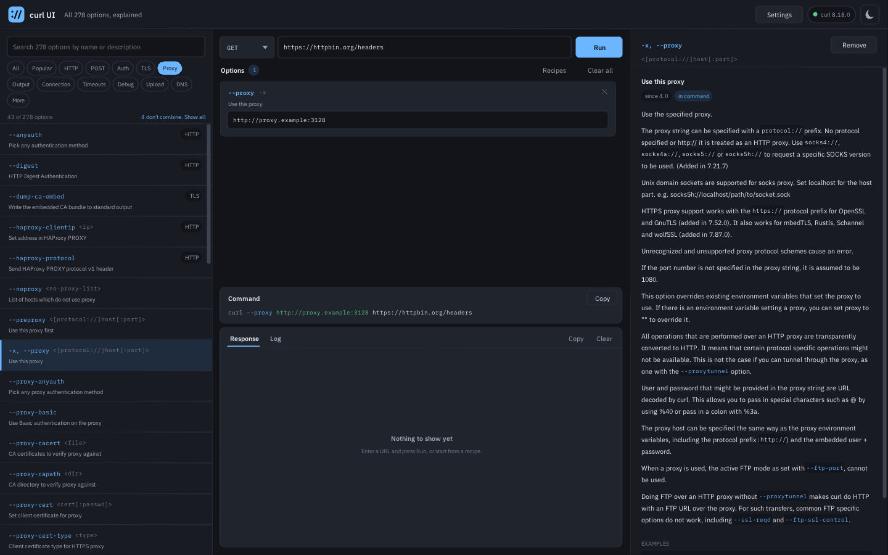
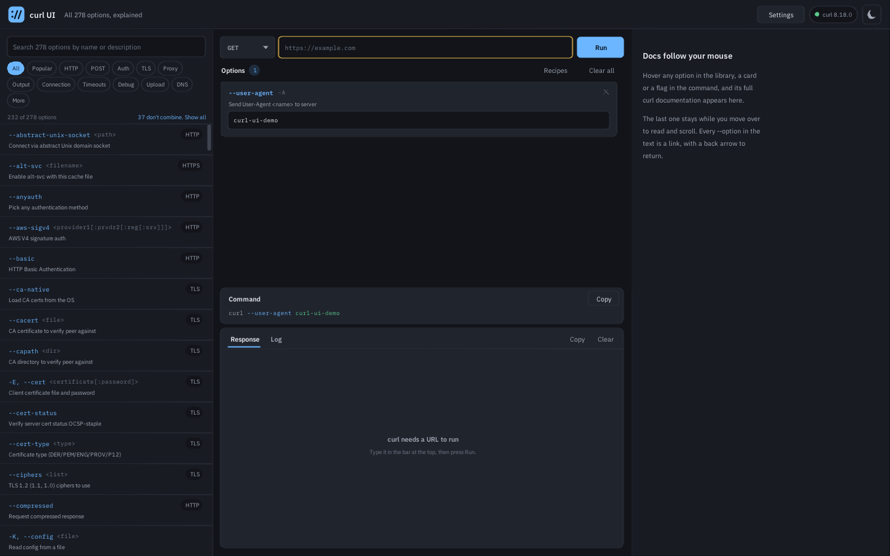

# curl UI

A native desktop front end for [curl](https://curl.se), written in C11 with
SDL2 and Nuklear. All 278 command line options, each with curl's own
documentation one mouse movement away. It runs your real `curl` binary and
re-implements nothing.

curl UI is an independent project and is not part of curl. The curl program is
not included: packages depend on it, and the app uses the one on your system.


## Why use it

- **Your real curl, nothing simulated.** The app starts the `curl` on your system
  with an argument array and no shell, so a result here is a result from curl.
- **Every option, documented in place.** All 278 options are searchable, and curl's
  own documentation appears as you hover over one. No switching to a man page.
- **Only what can work together.** After each choice the list narrows to the options
  that still combine with what you picked, and says why the others do not.
- **A command you can take with you.** The exact command is always on screen, and
  Copy gives you that text for a script, a CI job, a ticket or your documentation.
- **Private and local.** No account, no cloud and no telemetry. The app has no
  network code of its own: every connection is made by curl, when you press Run.
- **Small and native.** C11, SDL2 and Nuklear, with no browser engine. About a 1 MB
  download on Windows and macOS, free and open source.

## Who it is for

| You are | It helps you |
|---|---|
| A backend or API developer | try an endpoint and see status, time, size and formatted JSON, then keep the command |
| A QA or support engineer | reproduce a problem and attach the exact command and its log to the report |
| A DevOps or SRE engineer | check redirects, certificates, proxies and timeouts on the machine in question |
| Someone learning HTTP or curl | discover options by reading about them, and see what each one really does |

## Use cases

- **Debug an API call.** Start from the *Send JSON* recipe, add your headers, and run.
  The Response tab formats the JSON, and the Log tab shows what was sent and received.
- **Find out why HTTPS fails.** Add `--cacert`, `--resolve` or `--tlsv1.2`, and read the
  handshake in the Log tab, with the documentation for each option beside it.
- **Test through a proxy.** Pick the *Proxy* filter, add `--proxy` and its authentication
  options, and compare the result with a direct request.
- **Write a command for a script.** Build it with `--retry`, `--connect-timeout` and
  `--max-time`, confirm that it works, and copy it into your CI job.
- **Transfer files.** Download with `--remote-name` and `--limit-rate`, resume with
  `--continue-at`, or upload with `--upload-file`, over HTTP, FTP and the other
  protocols your curl supports.

## When something else fits better

curl UI runs one request at a time. It has no saved collections, shared team
workspaces, test suites or import from a pasted command, so a full API client suits
that work better. For repeated automation, use the copied command directly.

## Install

Download from the [releases page](../../releases), where `SHA256SUMS` lists the
checksums, or from the artifacts of the `curl-ui` workflow run:

| Platform | File | Install |
|---|---|---|
| Windows x64 | `curl-ui-*-windows-x64.exe` | run the installer (`.zip` is the portable form) |
| Windows ARM64 | `curl-ui-*-windows-arm64.exe` | run the installer (`.zip` is the portable form) |
| Debian, Ubuntu (x86_64, ARM64) | `curl-ui_*_amd64.deb`, `curl-ui_*_arm64.deb` | `sudo apt install ./curl-ui_*.deb` |
| Fedora, RHEL (x86_64, ARM64) | `curl-ui-*.x86_64.rpm`, `curl-ui-*.aarch64.rpm` | `sudo dnf install ./curl-ui-*.rpm` |
| Any Linux (x86_64, ARM64) | `curl-ui-*-linux-*.AppImage` | `chmod +x`, then run it; SDL is included |
| Any Linux (x86_64, ARM64) | `curl-ui-*-linux-*.tar.gz` | unpack; needs SDL2 installed |
| macOS Apple Silicon | `curl-ui-*-macos-apple-silicon.dmg` | drag to Applications |
| macOS Intel | `curl-ui-*-macos-intel.dmg` | drag to Applications |

The builds are not code signed, so Windows SmartScreen and macOS Gatekeeper warn
the first time. On Windows choose More info, Run anyway. On macOS 15 and later,
try to open the app, then choose Open Anyway in System Settings, Privacy & Security;
on older versions use right click, Open.

curl itself must be installed. Windows 10 and later and macOS include it. If
it is not on `PATH`, click the version pill in the header and enter its path under Program.

## Using it

- **Library, left:** search names and descriptions, or filter with the chips.
  Click a row to add that option.
  Once an option is chosen, the list shows only what can still combine with
  everything chosen so far: what conflicts, and what belongs to another protocol
  (`--ftp-pasv` rules out `--user-agent`), steps aside, with a count and a Show all
  link to see it anyway. Removing an option brings back what it ruled out.
  Deprecated options stay out of the list unless you search or use the Deprecated
  filter under More, which is why it starts at 269 of 278.
- **Centre:** method and URL on top, a card per added option, the exact command
  below (Copy gives the same text), and the output with Response and Log tabs.
  Press Enter in the URL, or Run. Recipes are starting points.
- **Docs, right:** hover a library row, a card or a flag in the command and that
  option's full documentation appears, and stays while you move over to read.
  Every `--option` in it is a link.

To fill the Log tab and the status chips, a run also passes `--verbose`,
`--no-progress-meter` and `--write-out` to curl, when you did not set them
yourself. The Log says so on its first line, and they are not in the command you
copy. The rest of the command is exactly what is executed, as an argument array
with no shell. This can be turned off in Settings.

### Screenshots

| Only what combines, or everything with the reason | The verbose log, in the light theme |
|---|---|
|  |  |

| Recipes to start from | Options filtered by topic |
|---|---|
|  |  |

| Settings | Guidance instead of a cryptic error |
|---|---|
|  |  |

## Settings

The Settings button in the header, or the curl version pill beside it, opens them.
Changes apply at once and are saved automatically; **Reset to defaults** restores
the values in bold.

| In the app | Choices | What it does | Key in the file |
|---|---|---|---|
| Theme | **Dark**, Light | Colour theme, also on the header button | `theme`: `dark`, `light` |
| Text size | **Auto**, 100%, 125%, 150%, 175%, 200% | Auto follows the display's scale | `text_size`: `0` for Auto, or a percent |
| Program | **`curl`**, or a name or path | Which curl to run. Detect checks it again | `curl_program` |
| Your config file | **empty**, or a path | Passed as `--config` on every run | `curl_config` |
| Ignore ~/.curlrc | On, **Off** | Starts every command with `--disable` | `ignore_curlrc`: `1`, `0` |
| Pretty JSON by default | **On**, Off | Formats valid JSON responses | `pretty_json`: `1`, `0` |
| Fill the Log tab and status chips | **On**, Off | Adds `--verbose`, `--no-progress-meter` and `--write-out` to runs | `capture_log`: `1`, `0` |
| Remember the last request | On, **Off** | Restores the request at the next start | `remember_request`: `1`, `0` |
| Docs hover delay | Instant, **Normal**, Slow | How long to hover before the docs change | `docs_hover_ms`: `0`, `110`, `300` |

The window size is kept too, as `window_width` and `window_height`, with no control
in the app.

The settings are a plain text file you can edit while the app is closed:

| Platform | File |
|---|---|
| Linux | `$XDG_CONFIG_HOME/curl-ui/settings.ini`, else `~/.config/curl-ui/settings.ini` |
| macOS | `~/Library/Application Support/curl-ui/settings.ini` |
| Windows | `%APPDATA%\curl-ui\settings.ini` |

Bad values and unknown lines are ignored, and the next save does not keep unknown
lines or your own comments. The file also accepts values the app does not offer:
`text_size` from 50 to 400 and `docs_hover_ms` from 0 to 2000. Then no choice is
highlighted on that row until you pick one.

With Remember the last request on, the request goes to `last-request.txt` next to the
settings, including any password in it. Both files are readable only by you on Linux
and macOS; on Windows they get the default permissions of your profile folder.
Turning the setting off deletes that file when the app closes.

On a Wayland session the app uses the native backend when libdecor is installed,
and XWayland otherwise. Set `SDL_VIDEODRIVER=x11` to force X11. `CURLUI_TRACE=1`
logs input events and window sizes to stderr, which helps in a bug report.

## Build

Requires CMake 3.16 or newer and a C11 compiler.

```sh
# Fedora: sudo dnf install cmake gcc sdl2-compat-devel rpm-build
# Debian: sudo apt install cmake gcc libsdl2-dev dpkg-dev
cmake -S . -B build
cmake --build build -j
ctest --test-dir build --output-on-failure
./build/curl-ui
```

Windows and macOS download SDL 2.30 and link it statically. To make installers
run `cpack` in the build directory: DEB, RPM and a tarball on Linux, NSIS and ZIP on Windows
(NSIS must be installed), a DMG on macOS. For a universal macOS build add
`-DCMAKE_OSX_ARCHITECTURES="arm64;x86_64"`.

`-DCURLUI_SANITIZE=ON` builds with ASan and UBSan. `-DCURLUI_BUILD_GUI=OFF`
builds only the core and its tests, with no SDL needed.

Generated files are committed, so building needs no Python:

| Regenerate | With | Needs |
|---|---|---|
| `src/core/options_data.c` | `tools/gen_options.py` | Python, git, network |
| `src/ui/fonts_data.{c,h}` | `tools/build_fonts.py` | `pip install fonttools brotli` |
| `packaging/curl-ui.{png,ico,icns}` | `tools/build_icons.py` | `pip install pillow` |

The option table comes from the curl release named in `tools/curl-ref.txt`. To
move to a newer curl, change that file, run `tools/gen_options.py`, and run the
tests. CI fails if the committed table differs from what that release generates.

## Testing

`ctest` covers the core and runs every option through the builder and process
runner, then through a real curl that parses it and stops before any transfer.

`tests/live/live_options.py --ui build/curl-ui` goes further: each of the 278
options is added to the real app, run, and judged by what came back, from public
test services (httpbin.org, badssl.com, test.rebex.net and others) and from local
servers for what has no public service (proxies, SOCKS, mail, TFTP, writable FTP).
It needs network, `openssl`, `ssh-keygen` and `pip install pyftpdlib`, so it is not
part of ctest. It reports each option as `effect` (the result proves it worked),
`ran` (it ran, but a client cannot see its effect) or `n/a` (this curl lacks it).

## Command line

These double as the test hooks. With `--screenshot` the app runs the script,
saves the image and exits; `SDL_VIDEODRIVER=dummy` makes that work headless.

| Option | Effect |
|---|---|
| `--url URL`, `--method NAME` | fill the request bar |
| `--add NAME[=VALUE]` | add an option, repeatable |
| `--neg NAME` | add an option in its `--no-` form |
| `--run` | run at startup |
| `--dump FILE` | with `--screenshot`: save the exit code, output and log |
| `--light` | light theme |
| `--docs NAME` | open the docs of an option |
| `--search TEXT` | fill the library search |
| `--log` | show the Log tab |
| `--size WxH` | window size |
| `--mouse X,Y`, `--click X,Y` | scripted mouse, in order given |
| `--wheel X,Y,DELTA` | scripted wheel |
| `--type TEXT` | scripted typing; a newline is Enter |
| `--screenshot FILE.bmp` | save the result and exit |
| `--stats` | print UI time per frame |
| `--settings-dir DIR` | keep settings in DIR. Scripted runs with `--screenshot` otherwise use none |

## Layout

```
  src/core/       no SDL, unit tested
    options*      the option table and search
    builder       options -> argv, shell-quoted preview
    procrun       posix_spawn / CreateProcessW runner
    outbuf        thread-safe, line-indexed, sanitizing output buffer
    json_fmt      strict JSON validator and pretty printer
    curlinfo      detects the installed curl and what it supports
    docs          curl's markdown-lite -> styled blocks
    settings      settings file and remembered request
    osthread.h    portable thread and mutex
  src/ui/         SDL + Nuklear: main loop, theme, views
  tests/          ctest: test_core and the echoargs helper
  tools/          generators
  third_party/    vendored Nuklear (commit in NUKLEAR_COMMIT)
  assets/fonts/   font sources and their licenses
  packaging/      icons, .desktop, Info.plist, .rc
```

## Known limitations

- No native file picker: type paths into the value fields.
- An option with an empty value is left out of the command, so a deliberately
  empty argument such as `-A ""` cannot be expressed.
- Options keep the order they were added, with the URL last. That is enough for
  most uses; `--next` sequences that need several URLs are not modelled, though
  `--url` can be added as an option.
- Output is held up to 8 MB; use `--output` for more. Text cannot be selected in
  the output, Copy takes the whole tab.
- At fractional desktop scales such as 125%, text is slightly softer than at 100%
  or 200%.
- `~` is not expanded in paths, since no shell is involved: use full paths.
- Text fields scroll sideways rather than wrap; long bodies are easier with
  `--data @file`.
- Line editing has no right-to-left or complex script shaping, and glyphs outside
  Latin, Greek and Cyrillic show as missing.

## License

See [LICENSE](LICENSE) for curl UI and its third-party notices.
